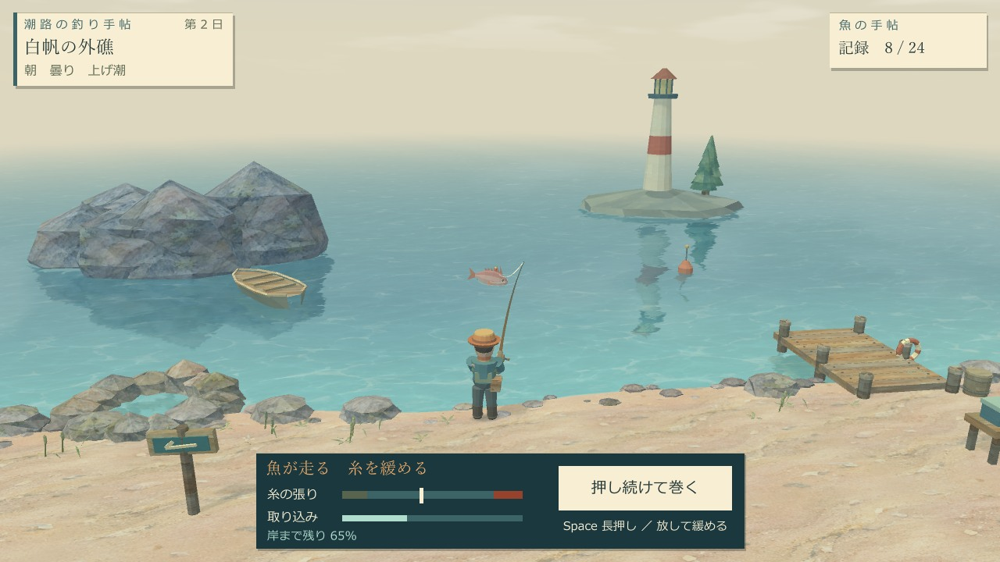

# 潮路の釣り手帖

源流の最初の依頼はオイカワ一尾です。岸で竿を構えて投げたら、浮きが完全に沈むまで待ちましょう。掛かった魚が走り出したら手を離し、休んだら巻くのが最初のコツです。取り込んだらJで依頼人に届けると、次の水辺への道が開きます。

| 場面 | 操作 |
| --- | --- |
| 投げる | WASD／矢印で歩き、岸でEかSpaceで構えます。左右で方向、上下で飛距離を選び、Spaceで投竿します。 |
| 合わせ・取り込み | 浮きが沈んだらSpace。魚が休んだらSpaceを長押しして巻き、走ったら離します。張り切った糸も、緩み切った糸も長く続くと魚が逃げます。 |
| 道具・時刻・渡航 | Bで売店と魚籠、Rで時刻、Tで釣り場を選びます。Xで仕掛けを回収、Pで合わせと取り込みに余裕がある「ゆっくり釣り」へ切り替えられます。 |
| 図鑑・依頼 | Hで手帖、Jで依頼。手帖では未発見の魚の条件を読み、狙う魚を追跡できます。釣った魚には標本画、釣った数、最大体長と最大重量が残ります。 |
| 釣果カード | 釣果画面でF8を押すと、標本画、体長・重量、釣った場所と条件を記したPNGを保存します。F9でカードの保存フォルダーを開けます。 |

源流・湖・漁港・外礁に6種ずつ、合わせて24種類の魚がいます。餌は川虫、練り餌、小魚、エビの4種類。時間帯、天気、潮、投げる距離を手帖の条件に合わせると、目当ての魚を狙えます。桜鱒、琵琶鱒、アカメ、ヒラマサを狙うときは、先に竿を1段階以上強化してください。

8件の依頼を通じて釣り場が広がります。魚籠を一括で売っても、進行中の依頼に必要な尾数を取り置きします。調査を終えた後には巡回依頼があり、異なる仕掛けで大物の記録に挑めます。

## 手動で調整する

- [Tides.unity](../Assets/Games/Tides/Tides.unity) を開き、**潮彩作品集 → 潮路の魚と依頼を編集** を選びます。「複製して追加」から、魚の大きさ、引きの強さ、餌、時間帯、潮、天気、飛距離を設定できます。魚のIDを指定して納品依頼も増やせます。
- 保存先は [Fishery.json](../Assets/Games/Tides/Resources/Tides/Fishery.json) です。既存の図鑑や依頼との対応を保つには、登録済みの魚IDを引き継いでください。独自の標本画は `Assets/Games/Tides/Resources/Tides/Fish/` に魚IDと同名の横長PNGを置けます。
- [TidesFishery.cs](../Assets/Games/Tides/TidesFishery.cs) が抽選、合わせの猶予、張力、体長・重量、売値と報酬を扱います。ゲーム内の釣り方や条件はここで調整できます。
