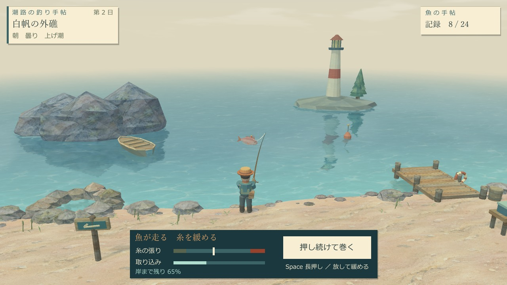

# F釣りゲーム

潮路の釣り手帖

源流、干潟、外礁へと釣り歩く、魚の手帖です。魚が走るときは糸を送り、休めば巻き取る。釣り上げた一尾が標本画になり、場所と大きさの記録が残ります。

**[ブラウザーで遊ぶ](https://kaxic.github.io/shiosai-tide-journal/)** ・ [A〜Fのゲーム一覧](https://kaxic.github.io/shiosai-game-library/#F)

[実際のプレイ映像を見る](https://kaxic.github.io/shiosai-tide-journal/media/demo.mp4)

## 最初にすること

最初の依頼は源流のオイカワ一尾。岸で川虫を付けて竿を構え、飛距離を決めて投げます。浮きがしっかり沈んだら合わせましょう。釣れた魚を依頼人に届けると次の水辺が開きます。

## 遊びの流れ

手帖に載る手掛かりを読み、餌・時刻・潮・投げる距離を変えて狙う魚を絞ります。掛かった後は張力を見ながら巻き、釣果を売って竿を強化。依頼に必要な尾数は売らずに取り置けます。

## 目指すもの

16件の依頼を進め、8か所の水辺にすむ48種の標本画を集めましょう。竿を鍛えたら源流のイトウや沖のクロカジキにも挑めます。手帖では魚種ごとに最大体長と最大重量を更新できます。

[遊び方と手動で拡張する方法](Guides/Tides.md)

## Unityで開く

Unity Hubでこのフォルダーを追加し、Unity 6000.3.28f1で `Assets/Games/Tides/Tides.unity` を開いて再生します。

Web版は Web Build Support を追加し、Unity の **Shiosai → Build browser game** から再ビルドできます。出力先は `docs` です。

[拡張版の内容](更新内容.md) ・ [Windows版をダウンロード](https://github.com/kaxic/shiosai-tide-journal/releases/latest)
